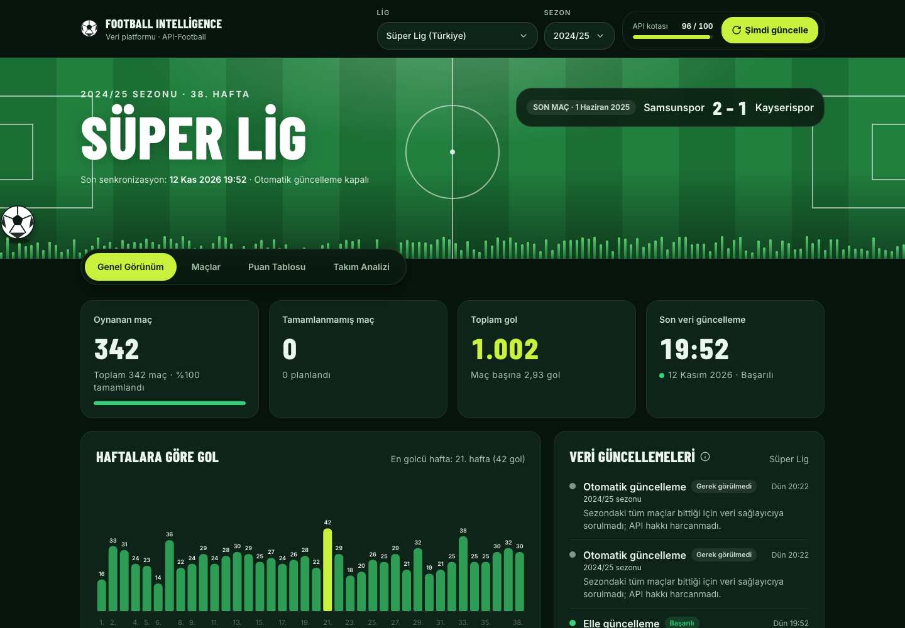
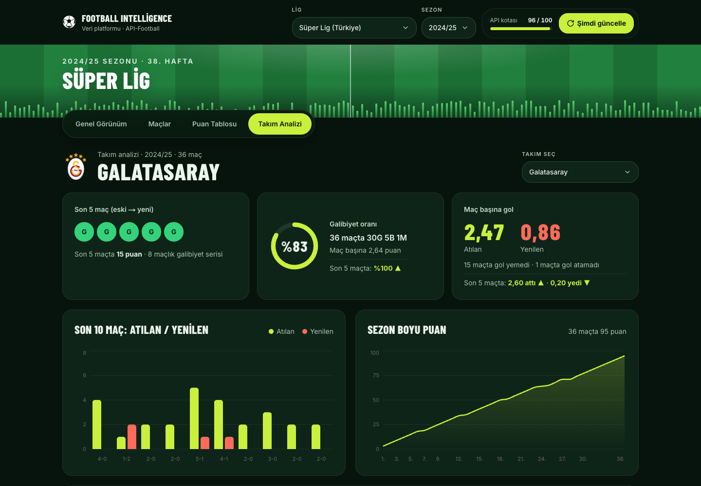
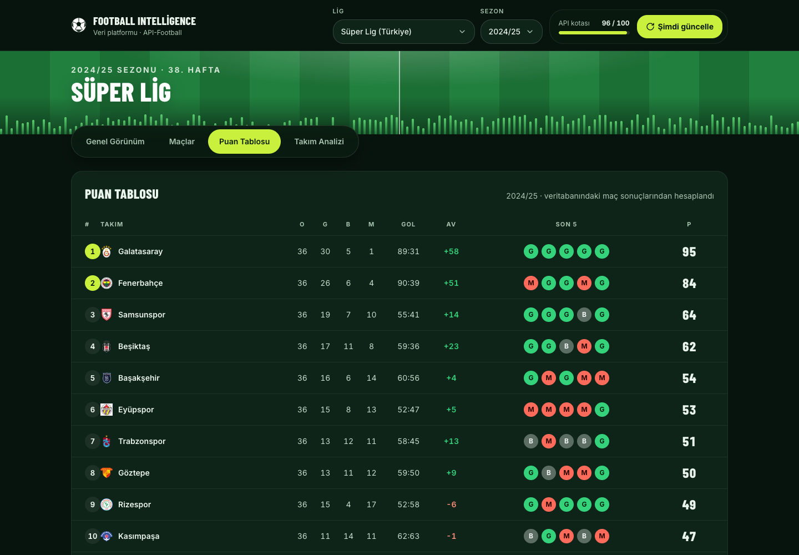
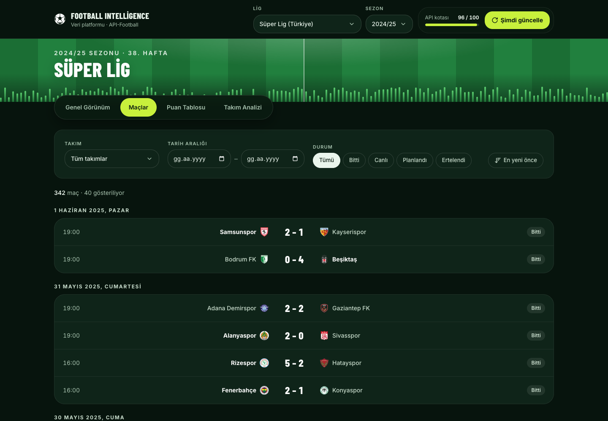

# Football Data Intelligence Platform

Beş büyük futbol liginin (Süper Lig, Premier League, La Liga, Bundesliga, Serie A) 2022/23, 2023/24
ve 2024/25 sezonlarını API-Football'dan alıp kendi veritabanında saklayan, puan tablosunu ve takım
istatistiklerini **kendisi hesaplayan** ve bunları bir web panelinde gösteren uygulama.

**Canlı demo:** _yayına alındığında eklenecek_

## Kısaca

- **Gerçek veri, az istek.** Ücretsiz paket günde 100 istek veriyor. Günlük güncelleme lig başına
  yalnızca 1 istek harcıyor; bitmiş sezonlar için hiç istek atılmıyor.
- **Veri kaynağı çökse de site çalışır.** Site her zaman kendi veritabanımızdan okur. Veri kaynağına
  yalnızca güncelleme sırasında gidilir.
- **Hazır istatistik kopyalanmaz.** Puan tablosu, form, galibiyet oranı ve gol ortalamaları maç
  sonuçlarından tek tek hesaplanır.
- **Her ligin kendi kuralları.** Örneğin puan eşitliğinde Süper Lig önce aralarındaki maçlara,
  Premier League genel averaja bakar. Puan silme cezaları ve küme düşme sınırları da ligden lige
  değişir. Bu kurallar her lig için ayrı bir ayar dosyasında durur; yeni bir lig eklemek için kod
  yazmak gerekmez.
- **Bonuslar:** maç istatistikleri, yapay zekâ ile iki takım karşılaştırması ve Docker ile tek
  komutla kurulum yapıldı. Canlı skor için ücretsiz pakette canlı maç olmadığından yalnızca planı
  yazıldı.

## Ekranlar

| Genel görünüm                                   | Takım analizi                               |
| ----------------------------------------------- | ------------------------------------------- |
|  |  |
| **Puan tablosu**                                | **Maçlar**                                  |
|  |      |

## İstenenler nasıl karşılandı?

Case dokümanının bölüm sırasıyla.

### 2. Veri toplama

| İstenen                                                                      | Nasıl                                                                                                                                         |
| ---------------------------------------------------------------------------- | --------------------------------------------------------------------------------------------------------------------------------------------- |
| Lig, sezon, takım ve maç bilgileri (tarih, durum, ev sahibi/deplasman, skor) | Hepsi API-Football'dan alınıyor (`/leagues`, `/teams`, `/fixtures`). Bir sezonun bütün maçları tek istekte geliyor                            |
| İstekler sunucudan atılmalı                                                  | Tarayıcı veri kaynağıyla hiç konuşmaz; yalnızca bizim sunucumuzla (backend API) konuşur                                                       |
| API anahtarı güvende olmalı                                                  | Anahtar yalnızca sunucudaki gizli ayar dosyasında (`.env`, ortam değişkeni). Kodda, GitHub'da ve tarayıcıda yok                               |
| Veri çekme tekrar çalıştırılabilmeli                                         | Güncelleme istendiği kadar tekrarlanabilir; aynı veri ikinci kez gelince kopya oluşmaz (idempotent sync)                                      |
| Eksik veri ve hatalar ele alınmalı                                           | Bilgisi eksik tek bir maç bütün güncellemeyi bozmaz: o maç atlanır ve not edilir, gerisi kaydedilir (güncelleme `partial` olarak işaretlenir) |

### 3. Veritabanı

| İstenen                                     | Nasıl                                                                                                                                                                                               |
| ------------------------------------------- | --------------------------------------------------------------------------------------------------------------------------------------------------------------------------------------------------- |
| Lig, sezon, takım ve maçlar birbirine bağlı | Tablolar ve aralarındaki bağlar: [veritabanı şeması](docs/database-schema.md)                                                                                                                       |
| Aynı maç ikinci kez kaydedilmemeli          | Her maç veri kaynağındaki numarasıyla tanınır. Tekrar gelirse yeni kayıt açılmaz, mevcut kayıt güncellenir (upsert, `external_id` üzerinde unique kısıt)                                            |
| Eksik değerler                              | Henüz oynanmamış maçın skoru boş bırakılır (`NULL`; 0-0 sayılmaz) ve hesaplara katılmaz                                                                                                             |
| Güncelleme geçmişi                          | Bir maçın skoru, durumu veya saati değişirse eskisi ve yenisi saklanır (`fixture_changes`); maç detayında görünür. Her güncellemenin ne zaman yapıldığı ve ne getirdiği de kayıtlıdır (`sync_runs`) |

### 4. Sunucu tarafı (backend)

İstenen sekiz işlevin hepsi FastAPI endpoint'i olarak var: lig ve sezon seçimi, takım listesi, maç
listesi, takıma ve tarihe göre filtreleme, takım istatistikleri, puan tablosu, veri güncelleme ve son
güncelleme durumu. Tam liste backend çalışırken `/docs` adresinde (OpenAPI).

**Kritik madde:** takım istatistikleri ve puan tablosu, veritabanındaki maç sonuçlarından bizim
tarafımızda hesaplanır (Python'da, ayrı bir analiz katmanında). Veri kaynağının hazır istatistik ve
puan tablosu endpoint'leri hiç kullanılmaz. Galibiyet oranı ve gol ortalamaları hem bütün sezon hem
son 5 maç için ayrı ayrı gösterilir.

### 5. Arayüz

| Ekran         | İçerik                                                                                                                                     |
| ------------- | ------------------------------------------------------------------------------------------------------------------------------------------ |
| Genel görünüm | Lig ve sezon seçimi, oynanan ve tamamlanmamış maç sayısı, toplam gol, son güncelleme zamanı, haftalara göre gol grafiği, güncelleme geçmişi   |
| Maçlar        | Tarihe göre maç listesi; takıma, tarihe ve maç durumuna göre filtre; skorlar; maç detayı                                                   |
| Puan tablosu  | Sıralama, oynanan / galibiyet / beraberlik / mağlubiyet, averaj, puan, son 5 maç; Avrupa kupası ve küme düşme bölgeleri                    |
| Takım analizi | Son 5 maç, galibiyet oranı, attığı ve yediği gol ortalamaları, iç saha / deplasman karşılaştırması, 2 grafik, yapay zekâ ile karşılaştırma |

Telefon ve bilgisayarda düzgün görünür (responsive). Bütün ekranlar gerçek veriyle, backend API'den
çalışır; örnek veri yoktur.

### 6. Otomatik güncelleme ve API limit yönetimi

| İstenen                         | Nasıl                                                                                                                                                                                                                                                                                             |
| ------------------------------- | ------------------------------------------------------------------------------------------------------------------------------------------------------------------------------------------------------------------------------------------------------------------------------------------------- |
| 1. İlk veri yükleme             | Tek komutla, istenen lig ve sezon için (`make sync`)                                                                                                                                                                                                                                              |
| 2. Elle güncelleme              | Panelin sağ üstündeki **"Şimdi güncelle"** butonu (`POST /api/v1/sync`)                                                                                                                                                                                                                           |
| 3. Zamanlanmış güncelleme       | Her sabah 07:00'de (Türkiye saati) kendiliğinden çalışır (sunucu içinde zamanlayıcı, cron ile ayarlanabilir)                                                                                                                                                                                      |
| 4. Gereksiz isteklerden kaçınma | Bitmiş sezonlar için istek atılmaz. Lig ve takım bilgisi bir kez alınır. Maç istatistikleri her maç için bir kez alınır                                                                                                                                                                           |
| 5. İstek sınırı ve hatalar      | Günlük hak yetmeyecekse güncelleme hiç başlamaz (kota kontrolü). İstekler dakikalık sınıra takılmayacak aralıkla atılır (rate-limit); yine de takılırsa bir dakika beklenip yeniden denenir (HTTP 429). Veri kaynağı geçici hata verirse birkaç kez daha denenir (retry, 5xx ve zaman aşımı için) |
| 6. Veri kaynağına ulaşılamazsa  | Site son kaydedilen veriyle çalışmaya devam eder. Yarıda kalan güncelleme mevcut veriyi bozmaz, tamamen geri alınır (transaction rollback)                                                                                                                                                        |
| 7. Kullanım takibi              | Panelin üstünde günün kalan istek hakkı (kota) görünür. Güncelleme geçmişinde her güncellemenin kaç istek harcadığı yazar (`api_usage`, `sync_runs`)                                                                                                                                              |

#### Hangi veri, ne sıklıkla ve neden?

| Veri                        | Ne zaman güncellenir                | Kaç istek                      |
| --------------------------- | ----------------------------------- | ------------------------------ |
| Lig, sezon ve takımlar      | Yalnızca ilk yüklemede              | 2                              |
| Maçlar (tarih, durum, skor) | Her sabah otomatik, istenirse elle  | Lig başına 1                   |
| Maç istatistikleri          | Biri o maçın detayını ilk açtığında | Maç başına 1, yalnızca bir kez |

Neden böyle:

- **Günde bir kez yeterli.** Ücretsiz pakette canlı skor yok; skor maç bitince kesinleşir. Gün
  içinde daha sık sormak yeni bir şey getirmez.
- **Neden sabah 07:00?** Bir önceki günün bütün maçları bitmiş olur. Günlük istek hakkı da gece
  yarısı yenilendiği için güncelleme dolu hakla çalışır.
- **Neden her seferinde bütün sezon?** Sadece son günleri istemek de 1 istek tutuyor. Bütün sezonu
  almak, ertelenen veya tarihi değişen maçları da yakalıyor.
- **Kota nasıl paylaşılıyor?** Beş ligin günlük güncellemesi en fazla 5 istek harcar; kalan 95 istek
  elle güncelleme ve maç istatistikleri için boş kalır. Maç istatistikleri günün son 10 hakkına
  dokunamaz; böylece otomatik güncellemeye her zaman yer kalır.

### 7. Bonuslar

| Bonus                                | Durum                                                                                                                                                                                                                                                                                                                                                                                                                                      |
| ------------------------------------ | ------------------------------------------------------------------------------------------------------------------------------------------------------------------------------------------------------------------------------------------------------------------------------------------------------------------------------------------------------------------------------------------------------------------------------------------ |
| **A – Canlı skor**                   | **Yapılmadı, planı hazır.** Ücretsiz paket yalnızca bitmiş sezonları veriyor; canlı maç olmadan çalıştığını gösteremezdik. Plan: yalnızca maç saatlerinde, bütün liglerin canlı maçlarını tek istekte (`/fixtures?live=...`) 5–10 dakikada bir sormak (polling). Maç olmayan saatlerde istek atılmaz. Yoğun bir maç günü yaklaşık 36 istek tutar. Sistem buna hazır: "canlı" durumu tanınıyor, skor değişiklikleri zaten geçmişe yazılıyor |
| **B – Maç istatistikleri**           | **Yapıldı.** Şut, topa sahip olma, korner, pas isabeti, gol beklentisi (xG) gibi 17 istatistik. Maç detayı ilk açıldığında alınır ve saklanır (lazy fetch, maç başına bir kez). Veri kaynağı o maç için istatistik vermiyorsa "istatistik yok" yazar                                                                                                                                                                                       |
| **C – Yapay zekâ ile karşılaştırma** | **Yapıldı.** İki takım seçilir, kısa bir yorum yazılır. Yapay zekâ hesap yapmaz: bütün sayılar bizim tarafımızda hesaplanıp ona verilir, o yalnızca yorumlar. Yazdığı metindeki her sayı verilerle karşılaştırılır; uymayan sayı varsa ekranda uyarı çıkar (grounding kontrolü). Aynı karşılaştırma veriler değişmedikçe tekrar üretilmez (cache). Ana LLM servisi (Gemini) yoğunsa yedek servis (OpenRouter) devreye girer (fallback)     |
| **D – Docker**                       | **Yapıldı.** Veritabanı, backend ve frontend tek komutla ayağa kalkar (`docker compose up`). Backend açılırken veritabanı tablolarını kendisi günceller (migration); veriler container silinse de kalıcı bir alanda (volume) durur |

### 8–9. Teknoloji ve teslimat

- İstenen teknolojiler aynen kullanıldı: Next.js, React, TypeScript, FastAPI, PostgreSQL,
  Tailwind CSS, shadcn/ui. Eklenen yardımcı araçlar ve nedenleri:
  [teknik ayrıntılar](docs/technical-details.md#teknoloji-seçimleri).
- **Otomatik testler:** 243 test. Puan tablosunun doğru sıralanması (eşitlik durumları dahil),
  takım istatistikleri, aynı maçın iki kez kaydedilmemesi, istek sınırı ve hata durumları,
  bütün endpoint'ler (pytest; birim ve gerçek PostgreSQL ile entegrasyon testleri). Kodda her
  değişiklikte GitHub Actions üzerinde otomatik çalışırlar (CI).
- Veritabanı şeması: [docs/database-schema.md](docs/database-schema.md). Ayar örneği:
  [.env.example](.env.example).

## Kurulum

API-Football'un [ücretsiz API anahtarı](https://www.api-football.com/) gerekir.

### Docker ile (önerilen)

Yalnızca Docker yeterli.

```bash
cp .env.example .env                 # API_FOOTBALL_KEY değerini yaz
docker compose up -d --build         # veya: make up
docker compose exec backend python -m scripts.initial_sync   # ilk veri: Süper Lig 2024/25 (3 istek)
```

Arayüz: http://localhost:3000 · API dokümantasyonu: http://localhost:8000/docs

Başka bir lig veya sezon eklemek için:
`docker compose exec backend python -m scripts.initial_sync --league 39 --season 2023` (3 istek).
Beş ligin üç sezonu toplam 45 istek tutar ve günlük hakka sığar.

### Geliştirme ortamı

Gerekenler: Python 3.12+ ve [uv](https://docs.astral.sh/uv/), Node.js 20+ ve pnpm 10, Docker
(yalnızca veritabanı için).

```bash
cp .env.example .env                           # API_FOOTBALL_KEY değerini yaz
cp frontend/.env.example frontend/.env.local

make install     # bağımlılıklar
make db-up       # veritabanı
make migrate     # tablolar
make sync        # ilk veri: Süper Lig 2024/25 (3 istek); başka lig: make sync LEAGUE=39 SEASON=2023

make dev         # backend:  http://localhost:8000/docs
make web         # frontend: http://localhost:3000  (ayrı terminalde)
```

Bütün komutlar: `make help`.

## Bilinen sınırlamalar

- **Lig kuralları resmi yönetmeliklerle madde madde karşılaştırılmadı.** Puan silme cezaları ve
  sıralamalar gerçek sonuçlarla kontrol edildi, ama ayar dosyalarında "doğrulanmadı" notu duruyor.
- **Güncel sezon yok.** Ücretsiz paket 2024/25'ten yeni sezonları vermiyor. Bu sezonlar bittiği
  için otomatik güncelleme her sabah "gerek görülmedi" diye kayıt düşer. Sistem devam eden bir
  sezon için tasarlandı ve testlerle doğrulandı.
- **Çok sayıda lig ilk kez yüklenirken** istekler dakikalık sınıra (rate-limit) göre aralıklandığı
  için işlem birkaç dakika sürebilir.

## Daha fazlası

- [Teknik ayrıntılar](docs/technical-details.md): mimari, lig kuralları, veri bütünlüğü, sunucu
  işlevlerinin listesi, ayarlar, teknoloji seçimleri, testler
- [Veritabanı şeması](docs/database-schema.md)
