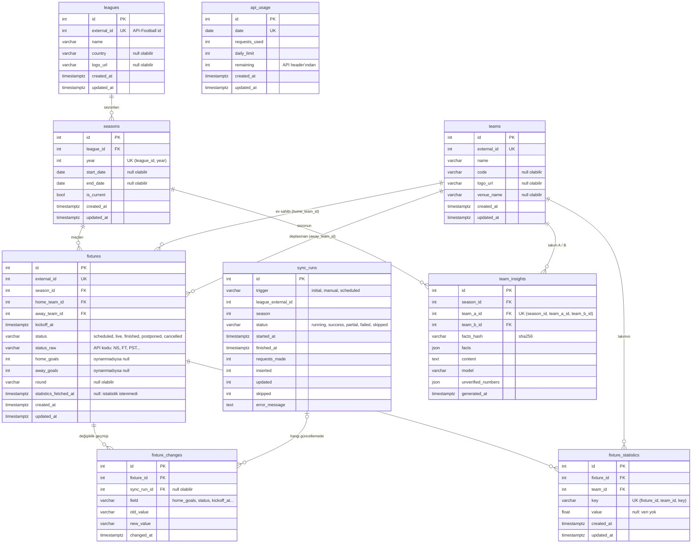

# Veritabanı şeması

PostgreSQL 16. Şema SQLAlchemy modellerinden ([backend/app/models](../backend/app/models)) Alembic
migration'larıyla ([backend/migrations/versions](../backend/migrations/versions)) oluşturulur:

```bash
make migrate
```

## İlişki diyagramı



## Tablolar

### Çekirdek veri

| Tablo | İçerik | Benzersizlik |
|---|---|---|
| `leagues` | Lig adı, ülke, logo | `external_id` (API-Football lig id'si) |
| `seasons` | Bir ligin bir sezonu: yıl, başlangıç/bitiş, güncel mi | `(league_id, year)` |
| `teams` | Takım adı, kısa kod, logo, stadyum | `external_id` |
| `fixtures` | Maç: sezon, ev sahibi / deplasman, başlama zamanı, durum, skor, hafta | `external_id` |

Takımlar bir lige değil maçlara bağlıdır: aynı takım farklı sezonlarda farklı liglerde
(yükselme / düşme) yer alabilir. "Bir sezonun takımları", o sezonun maçlarına çıkan takımlar
olarak hesaplanır.

### Geçmiş ve işletim

| Tablo | İçerik |
|---|---|
| `fixture_changes` | Bir maçın skor, durum veya saatindeki her değişiklik: eski ve yeni değer, değiştiren güncelleme |
| `sync_runs` | Her güncelleme çalışması: tetikleyen (ilk yükleme / elle / zamanlanmış), lig-sezon, sonuç, harcanan istek, eklenen / güncellenen / atlanan kayıt, hata mesajı |
| `api_usage` | Gün başına API isteği sayacı ve API'nin bildirdiği kalan kota |

### Bonus özellikler

| Tablo | İçerik | Benzersizlik |
|---|---|---|
| `fixture_statistics` | Maç istatistikleri, uzun formatta: maç × takım × istatistik başına bir satır | `(fixture_id, team_id, key)` |
| `team_insights` | AI karşılaştırma önbelleği: modele verilen veri, üretilen metin, model, doğrulanamayan sayılar | `(season_id, team_a_id, team_b_id)` |

## Tasarım kararları

**API kimliği ile iç kimlik ayrı.** Her tabloda kendi `id` (birincil anahtar) ve API-Football'un
`external_id`'si ayrı tutulur. İlişkiler iç id ile kurulur; upsert'ler `external_id` üzerinden
yapılır. Başka bir veri sağlayıcısına geçilse bile ilişkiler bozulmaz.

**Tekrar kayıt yok, değişmeyen satıra yazma yok.** Yazımlar
`INSERT ... ON CONFLICT (external_id) DO UPDATE ... WHERE (satır) IS DISTINCT FROM (yeni değer)`
ile yapılır. Aynı maç tekrar geldiğinde yeni satır açılmaz. Hiçbir alanı değişmediyse satıra
dokunulmaz; `updated_at` gerçek değişiklik zamanını gösterir ve eklenen / güncellenen sayıları
doğru raporlanır.

**Null'lar anlamlı.** Oynanmamış maçın skoru `NULL`'dur (0-0 değil); hesaplara katılmaz.
`statistics_fetched_at` doluysa API'ye o maç için bir daha sorulmaz, veri gelmemiş olsa bile.
`fixture_statistics.value` için `NULL` "API bu istatistiği vermedi" demektir; sayım türündeki
istatistiklerde API'nin 0 yerine gönderdiği `null` değerleri kural katmanında 0'a çevrilir.

**Durumlar VARCHAR, native enum değil.** `status`, `trigger` gibi alanlar uygulamada enum, veritabanında
VARCHAR'dır (SQLAlchemy doğrular). Yeni bir durum eklemek migration gerektirmez.

**Eşzamanlı güncelleme kilidi veritabanında.** `sync_runs` üzerindeki kısmi unique index
(`uq_sync_runs_single_running`: `status = 'running'` olan en fazla bir satır) aynı anda ikinci bir
güncellemeyi engeller. Kilit birden fazla süreçte veya sunucuda da geçerlidir. Takılı kalan
`running` kayıtları belirli süre sonra otomatik `failed` yapılır.

**İstatistikler uzun formatta.** Her istatistik ayrı bir sütun yerine ayrı bir satırdır. API yeni
bir istatistik eklediğinde şema değişmez, yalnızca kural spec'ine bir eşleme eklenir.

**Silme davranışı.** Bir lig silinirse sezonları, sezon silinirse maçları, maç silinirse geçmişi
ve istatistikleri de silinir (`ON DELETE CASCADE`). Bir güncelleme kaydı silinirse ilgili maç
değişiklikleri kalır, yalnızca bağlantı boşaltılır (`SET NULL`).

**Zamanlar UTC.** Tüm zaman alanları `timestamptz`'dir. Güncelleme kayıtlarının zamanları
veritabanı saatiyle (`now()`) yazılır; uygulama sunucusu ile veritabanı arasındaki saat farkı
sıralamayı bozmaz. Türkiye saatine çeviri arayüzde yapılır.

## İndeksler

| İndeks | Amaç |
|---|---|
| `external_id` (unique) — `leagues`, `teams`, `fixtures` | Upsert eşleşmesi |
| `fixtures(season_id)`, `fixtures(kickoff_at)`, `fixtures(status)` | Sezon maçları, tarih filtresi ve sıralama, bitmiş / bekleyen maç sayımı |
| `fixtures(home_team_id)`, `fixtures(away_team_id)` | Takım filtresi |
| `fixture_changes(fixture_id)`, `fixture_changes(sync_run_id)` | Maç geçmişi, güncellemenin değiştirdikleri |
| `fixture_statistics(fixture_id)` | Maç istatistikleri |
| `sync_runs(status)` + kısmi unique index | Çalışan güncelleme kilidi |
| `team_insights(generated_at)` | Günlük AI analizi sınırının sayımı |
